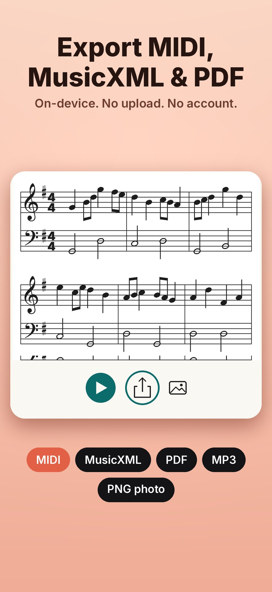

AI Music Radar listens while you play, sing or hum and writes the notes on a staff as you go. When you stop, you get an engraved score, a piano roll with playback, and MIDI, MusicXML and PDF export. All of the transcription happens on the iPhone. There is no sign-in, recordings are never uploaded, and it works in airplane mode.

```gallery
01-hear-it.jpg | The AI Music Radar library of recorded takes with a record button | Record a take or import audio
02-sheet-music.jpg | An engraved score with tempo, meter and key shown above the staff | The engraved page
04-piano-roll.jpg | The piano roll view of the same take | The piano roll
```

## From microphone to score

The pipeline has five steps, and each one is small enough to test on its own.

1. **Capture.** Audio from the microphone, or from a file you import, is converted to 22 kHz mono.
2. **Model.** Spotify's Basic Pitch, an open polyphonic transcription model, runs through Core ML on the iPhone's Neural Engine. It reads overlapping two-second windows and outputs, for every pitch and moment, how likely it is that a note starts or is sounding. Because the model is polyphonic, chords come through too.
3. **Decoder.** Swift code turns those probabilities into discrete notes with a start, an end and a velocity.
4. **Quantizer.** The notes are fitted to a tempo, a meter and a key, and snapped to a sixteenth-note grid.
5. **Engraving.** The app lays out the staff itself and highlights each note as it plays back.



The model weights are not stored in the source repository. They are pinned by SHA-256 in a lock file, checked on download and shipped as versioned release assets, so the app always runs the exact model that was tested.

## Better notes without retraining

The first round of accuracy work changed the decoder, not the model. Tuning its thresholds settled on an onset threshold of 0.7, a frame threshold of 0.4 and a minimum note length of 5 frames, about 58 ms. Note F1 on real recordings went up on all three test sets:

| Dataset | Before | After |
| --- | ---: | ---: |
| GuitarSet | 80.2 | 84.3 |
| MAESTRO | 69.5 | 73.5 |
| SMD | 70.3 | 76.2 |

## Loudness was really confidence

An audit of the dynamics found that note velocity was computed as 127 times the note's mean probability. That measures how sure the model is, not how loud the note was. A quiet, clean note could score 121 while a loud, noisy one scored lower.

Two fixes were compared against true velocities from the MAESTRO and SMD recordings (590 chunks, 29,373 matched notes): a small velocity head trained on top of the model, and a plain energy calibration per pitch. The calibration won, with a mean absolute error of 9.2 against 11.3 for the trained head. The old confidence-based estimate scored 19.4, worse than always guessing the median.

Note endings are the next weak spot. Tuning the decoder raised offset F1 from 0.202 to 0.245, at a cost of 0.031 onset F1. A dedicated note-off output is planned model work.

## Why the app draws its own staff

We looked at Verovio, a mature open source engraving library, and decided to keep the native Swift engraver for now. The Page view highlights notes during playback and maps taps to notes, and our layout already exposes every note's position to the UI directly. The native engraver is also about a thousand lines of Swift with unit tests. Verovio stays an option for export later, if the app grows into multi-voice notation, tuplets or slurs.

## Try it

The iPhone and iPad app is coming soon to the App Store. Until then you can see it at [music.grepawk.com](https://music.grepawk.com/), and try the same Basic Pitch model in your browser with the [web demo](https://grepawk.com/music-hear/).
