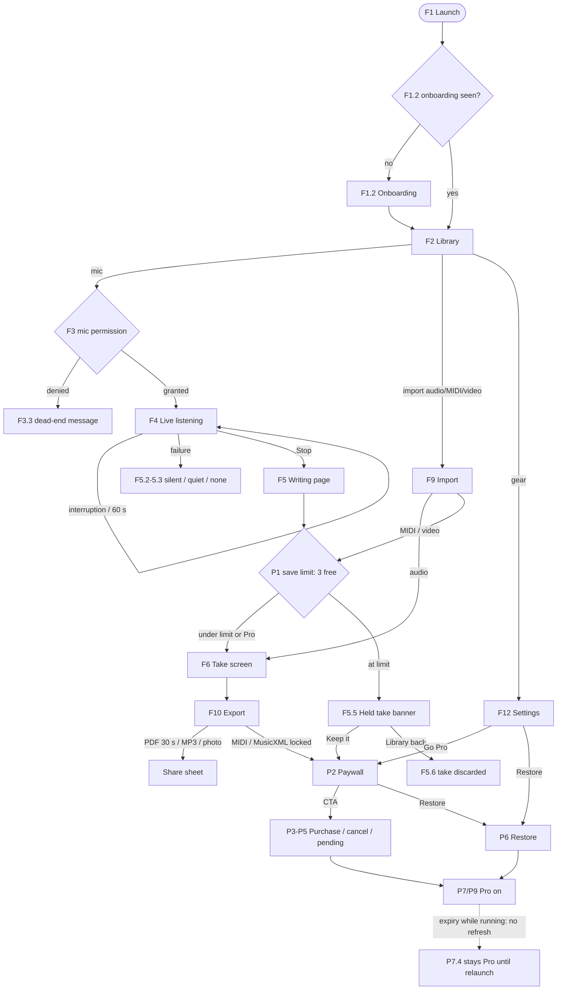

# AI Music Radar — user-flow audit (round 2)

- Repo: `yishengjiang99/earsheet` @ `0dba134` (main, includes prep PR #6) · bundle `com.ragnus.pnge` · iOS/iPadOS 17.0+ (`IPHONEOS_DEPLOYMENT_TARGET = 17.0`) · MARKETING_VERSION 1.0 · audit date 2026-10-17 (PT)
- Auditor mode: **static code read only** (Linux box, no Xcode/simulator; app never run). Unverifiable claims are tagged **(inferred)** / **[RUNTIME]**. Line refs are `path:line` at the SHA above; `App/` = `Sources/App/`.
- Not found in repo (so not audited): accounts/login, cloud sync, iCloud, widgets/extensions, camera, background audio, Now Playing/remote commands, in-app title rename, StoreKit Manage-Subscriptions UI, any server API other than `grepawk.com/music-radar/api/*`.
- Evidence read: AGENTS.md, README, docs/{paywall/PAYWALL_FLOW,iap/IOS_INTEGRATION,telemetry,asc/review_notes.txt,asc/metadata,legal/music-radar/privacy.html}, all of `Sources/App/**`, `Packages/HearSheet/.../AudioCapture.swift`, `Packages/SF2Player` audio-session code, `Products.storekit`, `EarSheet.xcodeproj` (scheme + usage strings), `Tests/**`, `.github/workflows/{ios-sim,ios-testflight}.yml`, `server/src/iap.ts`.

## ID scheme (stable, never renumber)
`F<n>` core flows · `P<n>` purchase / Pro flows · steps `F3.4`, `P7.4`. Bug titles are `[F3.4] symptom`. Risk: **H** likely user-visible bug / revenue / compliance · **M** fragile / unverified · **L** low.

## What the app actually does (verified from Sources/)
- **Input = microphone, live.** Tap mic → `ListeningSession` (`ListeningView.swift:11`) → `AVAudioSession.requestRecordPermission` (:58) → loads Core ML model (`ModelBox`) → `AudioRecorder` (`.playAndRecord`, `.measurement`, 22 050 Hz mono, `AudioCapture.swift:50`) → `StreamingTranscriber` pumps every ~1.6 s, live **piano roll** (no staff) → Stop → finalize + `Quantizer` → saved `Take` (score + raw `NoteEvent`s + session WAV). Max 60 s (`Transcriber.maxDurationSeconds`, `Transcriber.swift:13`). Audio never uploaded.
- **Other inputs:** import audio file / MIDI file (document picker `asCopy`) and video from Photos (audio track extracted). All capped at 60 s via `AudioImport.maxSamples`.
- **Result:** take screen = Piano roll / Page (engraved staff, lazy analysis for tempo/meter/key, tempo override), SF2 playback (`SF2MIDIPlayer`), export sheet (PDF, MP3, Photo, MIDI, MusicXML, plus "debug" mic WAV / note JSON), save page photo to Photos.
- **Free → Pro:** free = 3 saved takes, PDF first 30 s, no MIDI/MusicXML. Pro = auto-renew yearly/monthly (1-week trial) or Lifetime. `ProStore` (StoreKit 2) + `PaywallTriggers` (caps) + `PaywallView`. Server loop: `ServerSync`/`VerifyQueue`/`Telemetry` → `grepawk.com/music-radar`.
- **Documented but not implemented (verified by grep):** free 30 s import limit (`ProStore.freeImportSeconds` unused, `ProStore.swift:31`); triggers `importLimit`, `exportLockedRow`, `thirdTranscription`, `settings` (`PaywallTriggers.swift:14-20`; only `.saveLimit` is called, `LibraryView.swift:210`); soft interstitial; 3rd-transcription card; `PrivacyInfo.xcprivacy` (none in repo).

## Navigation model
`ContentView` (`ContentView.swift:7`): `hasSeenOnboarding` ? `LibraryView` : `OnboardingView`. `LibraryView` = `NavigationStack(path:[Take])` rooted at Library; push `SheetDetailView`; sheets: Settings, Paywall (import-limit path), AudioImporter, VideoPicker; `fullScreenCover`: `ListeningView` (inside its own NavigationStack). `SheetDetailView` sheets: Export (→ Paywall, ShareSheet), Tempo. One `ProStore`, one `TakeLibrary`, one `PaywallTriggers` created in `ContentView` and passed down.

## Persisted state
| Key / store | Meaning | Written at |
|---|---|---|
| `hasSeenOnboarding` (@AppStorage) | onboarding done | `ContentView.swift:9` |
| `pro.isPro`, `pro.lastRefresh` | cached Pro flag | `ProStore.swift:178-179` |
| `pro.appAccountToken` | per-install StoreKit token (UserDefaults, lost on reinstall) | `InstallIdentity.swift:37` |
| Keychain `installId` (+UserDefaults mirror) | anonymous install UUID | `InstallIdentity.swift:24` |
| `paywall.*` (autoDates, lastDismiss, dismissCount, rank4Shown/Returned) | prompt caps | `PaywallTriggers.swift:22-27,54-70` |
| `telemetry.optedOut` | analytics opt-out | `Telemetry.swift:111` |
| `push.enabled`, `push.registeredToken` | notification toggle/token | `PushManager.swift:86,111` |
| noise-gate / high-pass / `lastFloorDB/At` keys | mic conditioning | `SettingsView.swift:13-25`, `AudioCapture.swift:205` |
| `Application Support/<HearSheet bundle id>/takes.json` | whole library | `TakeLibrary.swift:256-260` |
| `Application Support/<bundle id>/<uuid>.wav` | per-take mic audio | `SessionDebugExport.swift:41-50` |
| `Application Support/EarSheet/{telemetry-queue,iap-verify-queue}.json` | offline queues | `Telemetry.swift:213`, `VerifyQueue.swift:96` |
| `tmp/*` | export files, picked-file copies, video copies | `ExportView.swift:114`, `ShareSheet.swift:73` |

## Permissions / entitlements
- `NSMicrophoneUsageDescription` = "AI Music Radar listens on this phone and writes the page here. The recording stays on the device." (`project.pbxproj:281`). Prompt is just-in-time on first mic tap.
- `NSPhotoLibraryAddUsageDescription` (save page photo). Photos import uses `PHPicker` (no permission). Notifications: system prompt only from Settings toggle.
- **No** `UIBackgroundModes`, no ATT, no camera/location. Orientation: iPhone portrait only; iPad all. `aps-environment=production` in `EarSheet.entitlements`.
- **No `PrivacyInfo.xcprivacy`** (find across repo: none) although the app uses `UserDefaults`.

## Index
| Flow ID | Name | Entry point | # steps | Risk |
|---|---|---|---|---|
| F1 | First launch, onboarding, bootstrap | App icon | 6 | M |
| F2 | Library home (samples, takes, delete, naming) | Root | 7 | M |
| F3 | Microphone permission & session start | Mic button | 6 | H |
| F4 | Live listening, interruptions, background, limit | Listening screen | 8 | H |
| F5 | Stop → write page → result / held take | Stop button | 7 | H |
| F6 | Take screen (piano roll, page, tempo) | Row tap / save | 6 | L |
| F7 | Library persistence & storage | Launch / any save | 5 | H |
| F8 | Playback | Play buttons | 5 | M |
| F9 | Import audio / MIDI / video | Import menu, video button | 8 | H |
| F10 | Export & share | Take → Export | 8 | M |
| F11 | Save page photo to Photos | Take → photo icon | 3 | L |
| F12 | Settings | Gear | 7 | M |
| F13 | Cross-cutting: errors, offline, storage | System | 4 | M |
| P1 | Free-tier limits & paywall triggers | Save/import/export | 12 | H |
| P2 | Paywall presentation & product load | Any paywall entry | 8 | H |
| P3 | Purchase success | Paywall CTA | 6 | H |
| P4 | Purchase cancel & failure | Paywall CTA | 4 | M |
| P5 | Pending / Ask to Buy | Paywall CTA | 4 | H |
| P6 | Restore purchases | Paywall / Settings | 4 | H |
| P7 | Entitlement checks: launch, renewal, expiry, refund, offline | Launch / background | 6 | H |
| P8 | Reinstall / new device | Launch | 2 | L |
| P9 | How paid features unlock and lock | Export, save, Settings | 4 | M |
| P10 | Telemetry, privacy & compliance of the funnel | Background | 5 | H |
| P11 | App Review & ops reachability | Review notes, ASC copy, CI | 3 | M |

## Overview
See `overview.png` (source `overview.mmd`).

---

# Part A — Core flows

### F1 — First launch, onboarding, bootstrap
Entry: cold start.
| Step | Expected | Acceptance | Risk / evidence |
|---|---|---|---|
| F1.1 | `EarSheetApp` → `ContentView`; `TakeLibrary`, `ProStore`, `PaywallTriggers` created once; no network needed to reach UI | Airplane mode cold start shows Library/onboarding < 2 s | L `EarSheetApp.swift:10`, `ContentView.swift:6-8` |
| F1.2 | Two-page onboarding once; Skip and "Get started" both set `hasSeenOnboarding`; never shown again | Fresh install: onboarding; relaunch: Library | L `OnboardingView.swift:14,45`, `ContentView.swift:9` |
| F1.3 | Entitlement refreshed from `Transaction.currentEntitlements` at launch; cached `isPro` seeds UI | Buy, kill, relaunch offline: still Pro | M `ContentView.swift:20-23`, `ProStore.swift:45-50` (see P7) |
| F1.4 | On active: `appOpen`(cold), `sessionStart`, push status refresh (no prompt), heartbeat `registerDevice`, telemetry flush, verify-queue drain; on background: flush under background task | Opt-out stops events but device record still sent (documented) | L `ServerSync.swift:45-75`, `EarSheetApp.swift:13-19` |
| F1.5 | Onboarding copy is truthful about data | Copy agrees with privacy page (usage events + device record are sent) | H "Nothing ever leaves your phone." `OnboardingView.swift:23` vs `privacy.html` (usage data, device record, purchase verification) → issue `[F1.5]` |
| F1.6 | Bundled sound font / models present; samples load async | Samples section appears; missing soundfont gives readable error | M `BundledModels.swift:12-13`, `TakeLibrary.swift:181-193` |

### F2 — Library home
Entry: root screen "Sheets".
| Step | Expected | Acceptance | Risk / evidence |
|---|---|---|---|
| F2.1 | Samples section + "My Takes"; empty text when none | Fresh install shows 2 samples + empty-state text | L `LibraryView.swift:29-47` |
| F2.2 | Row subtitle: date · notes · duration | Today/Yesterday/medium date correct | L `LibraryView.swift:343-358` |
| F2.3 | Row play/pause toggles inline playback; one take plays at a time | Tap row A then B: A stops, B plays | M `LibraryView.swift:317`, `TakeLibrary.swift:198-222` |
| F2.4 | Row body pushes take screen | Tap opens SheetDetailView | L `LibraryView.swift:99,328` |
| F2.5 | New take default titles are unique | After deleting "Take 2" of 3, next take is not a second "Take 3" | H `TakeLibrary.swift:96`, `ListeningView.swift:173` → `[F2.5]` |
| F2.6 | Swipe-delete removes take + its WAV + persists | Delete → relaunch → gone; WAV file gone | M `LibraryView.swift:46-48`, `TakeLibrary.swift:166-173`; no confirmation/undo (observation) |
| F2.7 | Toolbar: Settings (leading), Import menu (trailing), mic, video button | Gear opens Settings; mic starts F3 | L `LibraryView.swift:62,75,103-118` (gear is **top-left**; review notes say top right → `[P11.1]`) |

### F3 — Microphone permission & session start
Entry: mic button (Library), "Record again" (take screen, held-take dialog).
| Step | Expected | Acceptance | Risk / evidence |
|---|---|---|---|
| F3.1 | Tap mic stops playback, creates `ListeningSession`, presents full-screen cover | Cover appears; library playback stopped | L `LibraryView.swift:189-193` |
| F3.2 | First use: iOS permission prompt with the usage string, only now | Fresh install: prompt on first mic tap, not at launch | L `ListeningView.swift:58`, `project.pbxproj:281` |
| F3.3 | Denied/restricted: clear message **and** a way to fix (Open Settings) | Deny → message + "Open Settings" button; returning from Settings can retry | H message only, single button "Back to library" `ListeningView.swift:62,462-471` → `[F3.3]` |
| F3.4 | Granted: "Warming up…" while model loads, then listening | Model load < ~2 s warm; no stuck spinner | M `ListeningView.swift:70-94`; no escape during preparing → `[F4.7]` |
| F3.5 | Recorder start failure (no input, session error) shows readable text | Simulate no input: friendly message | M `AudioCapture.swift:86-90`, `ListeningView.swift:92` raw `error.localizedDescription` → `[F13.1]` |
| F3.6 | "Record again" from take / held take reuses the same flow | Held take → dialog → Record new take restarts in place | M `SheetDetailView.swift:99`, `ListeningView.swift:209-230` |

### F4 — Live listening
| Step | Expected | Acceptance | Risk / evidence |
|---|---|---|---|
| F4.1 | Level meter, red dot, `m:ss / 1:00`, live piano roll | Notes appear within ~2 s of playing | L `ListeningView.swift:345-395` |
| F4.2 | Streaming pump every ~1.6 s; UI stays responsive | 60 s take: no dropped UI, no memory growth | M `ListeningView.swift:98-112` (inferred) |
| F4.3 | Pump failure stops capture and shows readable error; mic released | Inject pump error: orange mic indicator off, Back works | H `phase = .failed` but `recorder.stop()` never called `ListeningView.swift:107-111` → `[F4.3]` |
| F4.4 | At 60 s auto-stop and tell the user why | Reach 60 s: take saved + visible message | M notice posted during `.writing`, view closes on `.done` → `[F4.4]` `ListeningView.swift:136-138,315-317` [RUNTIME] |
| F4.5 | Calls/Siri/route change: engine rebuilt, samples kept; UI reflects pause | Call during take → resumes after | M restarts on `.ended` only `AudioCapture.swift:140-176`; timer/UI show nothing while paused (inferred) |
| F4.6 | Lock screen / app switch while recording is handled (stop + save, or clear message) | Press lock mid-take: on return take is either saved or user told | H no `scenePhase`/`UIBackgroundModes` handling anywhere in `ListeningView.swift`/`EarSheetApp.swift` → `[F4.6]` [RUNTIME] |
| F4.7 | User can cancel/discard a session without creating a take | Cancel during warm-up and during listening → back to Library, nothing saved | H only Stop exists; Stop saves a take `ListeningView.swift:295-313,383-394` → `[F4.7]` |
| F4.8 | Session audio category does not break later playback | Record then play: audible, silent switch irrelevant | M recorder leaves `.playAndRecord/.measurement` active `AudioCapture.swift:50,178-188`; player sets `.playback` on load `SF2MIDIPlayer.swift:238` (inferred OK) |

### F5 — Stop → write page → result
| Step | Expected | Acceptance | Risk / evidence |
|---|---|---|---|
| F5.1 | Stop → "Finishing the take…" → result; mic released | Stop within 1 s of start doesn't crash | M `ListeningView.swift:114-190` |
| F5.2 | Silent / too-quiet takes give a clear retry | Cover mic: "Too quiet…" + Back | L `ListeningView.swift:121-130`; recording discarded without option to keep (observation) |
| F5.3 | No notes found: clear message | Noise only: "No notes found…" | L `ListeningView.swift:167-168` |
| F5.4 | Under limit/Pro: take added, cover closes, take screen opens, quota unaffected by failures | 3rd save works; failed takes don't count | M `ListeningView.swift:183-187`, `LibraryView.swift:139-153` |
| F5.5 | At free limit: take shown with non-blocking "Not saved yet" banner; paywall only from user action | 4th take → banner, no modal | M `ListeningView.swift:169-182,443-460` |
| F5.6 | Held take is never lost silently | "Library" back on held take asks first; Pro purchase saves it | H back button `dismiss()`s without confirmation; WAV orphaned `ListeningView.swift:297-302,215-218` → `[F5.6]` |
| F5.7 | Session WAV exists only for takes that exist | After failed/discarded sessions no stray WAV in Application Support | H WAV written at `ListeningView.swift:135` before outcome known → `[F7.3]` |

### F6 — Take screen
| Step | Expected | Acceptance | Risk / evidence |
|---|---|---|---|
| F6.1 | Opens on Piano roll; caption has note count + duration only | New take: no tempo/key until Page | L `SheetDetailView.swift:17,179-185`, test `SheetAnalysisTests` |
| F6.2 | Page tab runs lazy analysis once, cached | Open Page twice: analysis runs once | L `SheetDetailView.swift:121-125`, test exists; sync on main thread for 60 s take (inferred) |
| F6.3 | Tempo sheet re-quantizes | Apply 2× changes note lengths | L `SheetDetailView.swift:130-141` |
| F6.4 | Play/pause with highlight; stops on tab switch/disappear | Switch tab: stops | L `SheetDetailView.swift:83,121-124,150` |
| F6.5 | Record again opens a new session | New take opens after save | L `SheetDetailView.swift:99` |
| F6.6 | Export button runs analysis then opens Export | Export PDF matches Page | L `SheetDetailView.swift:91` |

### F7 — Library persistence & storage
| Step | Expected | Acceptance | Risk / evidence |
|---|---|---|---|
| F7.1 | `takes.json` loads at launch; a read/decode failure never destroys data | Corrupt file → user told, file preserved, next save does not overwrite | H `try?` + `else { return }` then `save()` overwrites `TakeLibrary.swift:248-259` → `[F7.1]` |
| F7.2 | Save on add/delete/tempo; write failures reported | Disk full: user told | H `try? data.write` `TakeLibrary.swift:256-260` (same issue) |
| F7.3 | WAV files == takes referencing them | Failed/discarded sessions leave no file; delete removes | H see F5.7 |
| F7.4 | Queues bounded (5000 events, 200 verify items) | Offline for weeks: files stay small | L `Telemetry.swift:65`, `VerifyQueue.swift:24` |
| F7.5 | Temp files from picks/exports are cleaned | After many imports tmp does not grow | M `ShareSheet.swift:14,73`, `LibraryView.swift:197-308` (audio/MIDI copies never removed) → `[F9.8]` |

### F8 — Playback
| Step | Expected | Acceptance | Risk / evidence |
|---|---|---|---|
| F8.1 | Play loads soundfont + MIDI, plays; missing soundfont is readable | Tap play on sample: audio within ~1 s | M `TakeLibrary.swift:198-222`; raw "Playback failed: \(error)" :219 → `[F13.1]` |
| F8.2 | Note highlights follow score ids | Staff/roll highlight moves | L `TakeLibrary.swift:211-215` |
| F8.3 | Interruption/route handling in player | Call mid-play pauses/resumes | M `SF2MIDIPlayer.swift:433-462` (inferred) |
| F8.4 | Stop on tab change, disappear, delete | Delete playing take stops | L `TakeLibrary.swift:166-173`; delete stops *any* playback (observation) |
| F8.5 | Rapid taps on different rows leave UI and audio consistent | Tap A,B quickly | M unstructured `Task` per tap `TakeLibrary.swift:205` (inferred) [RUNTIME] |

### F9 — Import audio / MIDI / video
| Step | Expected | Acceptance | Risk / evidence |
|---|---|---|---|
| F9.1 | Import menu: audio/MIDI picker, video from Photos | Picker lists audio + .mid | L `LibraryView.swift:109-118`, `ShareSheet.swift:14` |
| F9.2 | Immediate progress while decoding/transcribing; empty audio reported | Pick a 50 s file: spinner/overlay until result or message; silent file → message | H no progress state at all; `guard !samples.isEmpty else { return }` silent `LibraryView.swift:256,287` → `[F9.2]` |
| F9.3 | MIDI parsed directly; empty / bad file messages | Bad file → "Could not read that MIDI file." | L `LibraryView.swift:224-245` |
| F9.4 | **Every** import path obeys the 3-piece free limit | Free user with 3 takes imports an m4a → paywall/held, not saved | H `importAudio` calls `library.addTake` directly `LibraryView.swift:297-301` vs gated `saveImportedScore` :207 → `[F9.4]` |
| F9.5 | Import held at the limit is visible and recoverable | Dismiss paywall: banner/notice shows the held piece; never silently replaced | H `pendingScore` is invisible state `LibraryView.swift:20,209-215,163-173` → `[F9.5]` |
| F9.6 | Specific errors: too long (>60 s), no audio track, unsupported | 90 s file → "Files can be up to 60 seconds" | H all errors → generic text `LibraryView.swift:274-276,304-306`; `ImportError` cases `AudioCapture.swift:307-311` → `[F9.6]` |
| F9.7 | Video import extracts audio track, same flow | Short video with music → take | M `LibraryView.swift:248-278` |
| F9.8 | Picked-file copies deleted after use | tmp empty after import | M video copy removed only on some paths; audio/MIDI never → `[F9.8]` |

### F10 — Export & share
| Step | Expected | Acceptance | Risk / evidence |
|---|---|---|---|
| F10.1 | Export sheet lists PDF, MP3, Photo, (debug), MIDI, MusicXML with lock icons for Pro | Free: lock on MIDI/MusicXML only | L `ExportView.swift:24-72` |
| F10.2 | Free PDF = first 30 s; Pro full | 45 s take: free PDF has only first 30 s | M `ExportView.swift:101-107`, no notice when truncated (observation) |
| F10.3 | MP3 render shows progress and can't be double-started | Tap MP3: spinner; second tap ignored | H `isPreparing` set, never read `ExportView.swift:18,142-151` → `[F10.3]` |
| F10.4 | Photo export shares PNG | PNG opens | L `ExportView.swift:154-161` |
| F10.5 | MIDI/MusicXML tap → paywall; after purchase the export proceeds | Buy from export row → user lands with file ready | M `ExportView.swift:131-139` (resume absent → ENH `[P3.5]`) |
| F10.6 | File names keep the take title (incl. non-Latin) | Title "夜曲" → "夜曲.pdf" | M regex removes all non `[a-zA-Z0-9-_ ]` → `.pdf` `ExportView.swift:109-111` → `[F10.6]` |
| F10.7 | Developer-only export UI not shown to end users; no silent clipboard writes | Production build has no "Debug export" text/clipboard write | H `ExportView.swift:39-54,179-184`, `ListeningView.swift:304-312,418-440` → `[F10.7]` |
| F10.8 | Share sheet works on iPhone/iPad | iPad popover anchors | M `ShareSheet.swift:88-95` (inferred) |

### F11 — Save page photo
| F11.1 | `.addOnly` permission just-in-time | First tap prompts | L `SheetDetailView.swift:192-215` |
| F11.2 | Denied: message with Settings pointer | Deny → readable text | L `SheetDetailView.swift:215-216` (no button; same pattern as F3.3, accepted P3) |
| F11.3 | Success/failure reported | "Saved to Photos." | L `SheetDetailView.swift:223-232` |

### F12 — Settings
| Step | Expected | Acceptance | Risk / evidence |
|---|---|---|---|
| F12.1 | "Go Pro" row shows status; Pro users get status/manage, not a purchase screen | Pro: row says "You have Pro" and opens manage/status | H opens full purchase paywall even when Pro `SettingsView.swift:32-47` → `[P2.8]` |
| F12.2 | Restore Purchases with progress and result message | None found → "No purchases to restore"; success → confirmation; failure → message | H no alert in Settings; `purchaseError` only shown by `PaywallView.swift:89-97` → `[P6.2]` |
| F12.3 | Notifications toggle: prompt only here; denied → hint | Deny → toggle off + footer | L `SettingsView.swift:61-70`, `PushManager.swift:78-89`, tests |
| F12.4 | "Share anonymous usage data" toggle; off clears queue | Off → no events; footer matches privacy page | L `SettingsView.swift:71-72`, `Telemetry.swift:108-114`, `testOptOutSuppressesAllSends` |
| F12.5 | Noise gate / rumble filter / reset | Reset restores defaults | L `SettingsView.swift:83-120` |
| F12.6 | "Measure now" checks permission, reports failure, never stores a bogus floor | Deny mic → message, floor unchanged | H `recorder.start()` error silently ignored; no permission check `SettingsView.swift:195-208` → `[F12.6]` |
| F12.7 | Privacy / Terms / Support links | Open grepawk.com/music-radar/* | L `SettingsView.swift:123-149` |

### F13 — Cross-cutting
| F13.1 | No raw Swift/Foundation error text shown to users | Force errors: friendly copy | H `localizedDescription` interpolated: `ListeningView.swift:92,109,157`, `TakeLibrary.swift:219`, `ExportView.swift:120,148`, `SheetDetailView.swift:230` → `[F13.1]` |
| F13.2 | Offline: all core flows work; sync is best-effort | Airplane mode record→save→export | L `ServerSync.swift:5-6`, `APIClient.swift:51-54` |
| F13.3 | Storage full handled | see F7.2 | H |
| F13.4 | iPhone portrait only; iPad all four | Rotation on iPad OK | L pbxproj :286-287 |

---

# Part B — Purchase / IAP flows (priority)

Products (`Products.storekit`, mirrors ASC): `com.ragnus.pnge.pro.yearly` $29.99/yr level 1, `com.ragnus.pnge.pro.monthly` $4.99/mo level 2 (same group "AI Music Radar Pro"), each with a **free 1-week intro offer**; `com.ragnus.pnge.lifetime` non-consumable $49.99. Family Sharing off, storefront USA, `_failTransactionsEnabled=false`. Scheme attaches the file to the Debug launch action only (`EarSheet.xcscheme:64-66`, asserted by `PaywallPricingTests.swift:159`). Existing automated coverage: pricing/copy helpers, products load via `SKTestSession` (`PaywallPricingTests.swift:175`), cache round-trip (`ProStoreTests`). **No** test covers purchase, restore, pending, expiry, refund or quota gates.

### P1 — Free-tier limits & triggers
| Step | Expected | Acceptance | Risk / evidence |
|---|---|---|---|
| P1.1 | Mic save beyond 3 holds the take (not blocked, not lost) | 4th recording shows banner | M `ListeningView.swift:169-182` |
| P1.2 | Quota counts only takes actually saved; failed sessions free | Failed/silent takes don't consume | L takes only added on success |
| P1.3 | Limit evaluated against current Pro state | Pro on → save proceeds | M cached `isPro`; see P7 |
| P1.4 | Auto-paywall caps: 1/session, 2/7 d, 72 h cooldown after dismiss, ≥5 dismissals stop, rank-4 once+once | Unit test on injected defaults + clock | M `PaywallTriggers.swift:34-52`; storage in `UserDefaults.standard` (not injectable) |
| P1.5 | Free import limited to 30 s (as paywall table, design doc, review notes); Pro length matches claims | 45 s file: free = first 30 s transcribed + prompt; Pro = full (≤ stated max) | H not implemented; all files ≤60 s transcribe fully, longer fail; "Full-length" claim false → `[P1.5]` `ProStore.swift:31`, `PaywallView.swift:110,244,255`, `review_notes.txt:16` |
| P1.6 | Free PDF 30 s | see F10.2 | M |
| P1.7 | MIDI/MusicXML lock | Tap → paywall | L `ExportView.swift:132,137` |
| P1.8 | Only automatic triggers count toward caps; user-tapped paywalls never | Tap "Keep it" banner, dismiss: no cooldown | M `ListeningView.swift:332-336` counts user-initiated dismiss → `[P1.8]` |
| P1.9 | All designed triggers exist behind one gate | importLimit/exportLockedRow/settings/thirdTranscription wired | M only `.saveLimit` used `LibraryView.swift:210` → ENH `[P1.9]` |
| P1.10 | Free users can see how many saves remain | "2 of 3" visible | M absent → ENH `[P1.10]` |
| P1.11 | Import-over-30 s prompt (design screen 7) | Prompt offers free 30 s or Pro | M absent → ENH `[P1.11]` (after `[P1.5]`) |
| P1.12 | 3rd-transcription inline Library card (rank 4) | Card shows once, returns once after 14 d | M absent (caps exist `PaywallTriggers.swift:34-52`) → ENH `[P1.12]` |

### P2 — Paywall presentation & product load
| Step | Expected | Acceptance | Risk / evidence |
|---|---|---|---|
| P2.1 | Entry points: Settings Go Pro, import save-limit auto, held-take banner/dialog, export locked rows | Each opens one paywall instance | M `SettingsView.swift:159`, `LibraryView.swift:155`, `ListeningView.swift:326`, `ExportView.swift:81` — four separate sheets |
| P2.2 | Products load once, loading state, yearly first/preselected | Yearly selected, order yearly→monthly→lifetime | L `ProStore.swift:59-89`, `PaywallView.swift:13,83-87`; tests |
| P2.3 | Load failure shows one message + Try Again; empty is handled | Offline: single message + retry | L `ProStore.swift:74-78`, `PaywallView.swift:129-149,211` |
| P2.4 | Prices from StoreKit; trial copy only when eligible | Ineligible account: no "free" text | L `PaywallPricing.swift`, tests |
| P2.5 | Disclosure, Terms (Apple EULA), Privacy, Restore visible | All present on screen | L `PaywallView.swift:195,263-278` |
| P2.6 | Close button from first frame; dismissal during purchase safe | Tap × while purchase sheet open | M `PaywallView.swift:76-82` not disabled while `isPurchasing` (purchase continues via `Transaction.updates`; acceptable) |
| P2.7 | Copy equals real gates | Table matches code | H import row wrong (P1.5) |
| P2.8 | Pro user cannot buy again by accident | Pro opens Settings → Go Pro: status, no CTA | H `SettingsView.swift:32`, `PaywallView.swift` never reads `isPro` → `[P2.8]` |

### P3 — Purchase success
| Step | Expected | Acceptance | Risk / evidence |
|---|---|---|---|
| P3.1 | CTA buys selected plan with `appAccountToken` | Sheet appears; spinner on CTA | L `ProStore.swift:108-114`, `PaywallView.swift:227-237` |
| P3.2 | Verified → report → finish → refresh → dismiss; quota unchanged | Pro true, paywall closed | L `ProStore.swift:116-122` |
| P3.3 | JWS queued for server and retried | Offline then online: delivered | L `ServerSync.swift:82-90`, tests |
| P3.4 | Held take / held import resumes after purchase | Buy at limit: take saved & opened | M `ListeningView.swift:337-342`, `LibraryView.swift:163-173` (import held state invisible → F9.5) |
| P3.5 | Confirmation + resume of the export the user tapped | Buy from MIDI row: file offered | M absent → ENH `[P3.5]` |
| P3.6 | Buying a second product while entitled is guarded (sub→lifetime, monthly↔yearly) | Warn/disable owned | M follows P2.8 |

### P4 — Cancel & failure
| P4.1 | Cancel: no error, buttons re-enabled | S6 | L `ProStore.swift:123-125` |
| P4.2 | Failure copy is plain language; unverified distinguishable | S7/S11 | M raw `localizedDescription`, `ProStoreError` unverified → "Purchase failed: The operation couldn't be completed (EarSheet.ProStoreError error 0)" `ProStore.swift:117,135` → `[P4.2]` |
| P4.3 | Failed purchase leaves Pro untouched, retry works | S7 | L |
| P4.4 | Telemetry distinguishes cancel / pending / error | funnel readable | M cancel & pending logged as `purchase_fail` `ProStore.swift:124,128` → `[P10.2]` |

### P5 — Pending / Ask to Buy
| P5.1 | Pending → neutral message, not an error | S8 | M `ProStore.swift:126-129` alert titled app name, OK button (acceptable) |
| P5.2 | Approval later → Pro within ~5 s | S8 | L `Transaction.updates` → `refreshEntitlement` `ProStore.swift:193-204` |
| P5.3 | UI follows approval: paywall closes, Pro state shown | S8 | H `PaywallView` only dismisses via `buySelected` return value `PaywallView.swift:227-237` → `[P5.3]` |
| P5.4 | Decline clears pending, no Pro | S8 | L |

### P6 — Restore
| P6.1 | Paywall Restore with progress; success dismisses | S10a | L `PaywallView.swift:56-62` |
| P6.2 | Settings Restore gives the same feedback | S10a-c | H none → `[P6.2]` |
| P6.3 | None found → "No Pro purchase found" | S10b | M text exists in alert, paywall only `ProStore.swift:156-158` |
| P6.4 | Sign-in cancelled is silent; offline retryable | S10c/d | H `AppStore.sync()` cancellation → "Restore failed: …" `ProStore.swift:147-152` → `[P6.4]` |

### P7 — Entitlement checks
| P7.1 | Launch refresh from `currentEntitlements` | S16/S17 | L `ContentView.swift:20-23` |
| P7.2 | Renewal/refund/approval via `Transaction.updates` | S13/S14 | L `ProStore.swift:193-204` |
| P7.3 | Offline launch keeps Pro; never blocks | S18 | L cache + local entitlements `ProStore.swift:45-47,165-180` |
| P7.4 | Expiry while the app is alive is noticed on next foreground/gate | S12 | H refresh only at launch task; no `scenePhase`/gate refresh; `Transaction.updates` has no expiry event → stays Pro until relaunch `ContentView.swift:20-23`, `EarSheetApp.swift:13-19` → `[P7.4]` |
| P7.5 | Multiple entitlements: refund of one keeps Pro if another valid | S14 | L any-of logic `ProStore.swift:167-175` |
| P7.6 | Grace/billing retry keeps Pro | S15 | L (`currentEntitlements` includes grace) (inferred) |

### P8 — Reinstall / new device
| P8.1 | Entitlement auto-restored at first launch (no tap) | S16 | L same refresh |
| P8.2 | Restore reachable from Settings | S16 | see P6.2 |

### P9 — Unlock / lock
| P9.1 | Gate table: save>3, MIDI, MusicXML, PDF>30 s, import>30 s | table test | H import row missing |
| P9.2 | Lapse: existing takes remain, new saves gated | S12 | L |
| P9.3 | UI immediately reflects Pro in Settings/export locks | S4 | L `@Published isPro` |
| P9.4 | Pro status + Manage Subscription entry | n/a | M absent → ENH `[P9.4]` |

### P10 — Telemetry, privacy, compliance
| P10.1 | Only allow-listed scalar props sent | `testSampleBatchCarries…` | L `Telemetry.swift:62-65,198-211` |
| P10.2 | Funnel events: view, start, success, fail(cancel/pending/error), restore, dismiss, trigger | funnel analyzable | M no dismiss/trigger/restore-tap; mislabeled fail → `[P10.2]` |
| P10.3 | Opt-out stops usage events; device record/purchase verification documented | privacy page agrees | L tested |
| P10.4 | `PrivacyInfo.xcprivacy` declares UserDefaults reason + collected data matching privacy page | file present in app target | H none in repo → `[P10.4]` |
| P10.5 | Verify queue never drops a real purchase on transient 4xx | S3 | M `isPermanent` = any 4xx except 408/429; 3 rejections drop (`APIClient.swift:37-39`, `VerifyQueue.swift:77-82`) — noted, no issue (server-side record only) |

### P11 — Review & ops reachability
| P11.1 | Review notes reach paywall and cover microphone testing | S22 | H gear described "top right" (is top-left), claims "full-length imports", no mic guidance `review_notes.txt:5-16`, `LibraryView.swift:103` → `[P11.1]` |
| P11.2 | Store copy matches behavior | – | M "writes the score live"/"Live Audio to Sheet Music" vs piano-roll-only live view `description.txt:1,11`, `subtitle.txt:1` → `[P11.2]` (owner decision) |
| P11.3 | StoreKit config attached to scheme; sim CI manual-only; TF workflow fails unless VALID | – | L scheme ok (path form `../../Products.storekit` asserted by test; **[RUNTIME]** whether Xcode resolves it); `ios-sim.yml` dispatch-only after PR #6; `ios-testflight.yml:419-452` waits for VALID |

---

# Part C — StoreKit test plan (Products.storekit)
Envs: **E1** Xcode StoreKit Testing (scheme-attached `Products.storekit`; Debug → StoreKit → Manage Transactions), **E2** XCTest + `SKTestSession(contentsOf: Products.storekit)` (`resetToDefaultState`, `clearTransactions`, `disableDialogs`, `buyProduct`, `expireSubscription`, `refundTransaction`, `askToBuyEnabled`, `failTransactionsEnabled`), **E3** Sandbox via TestFlight (sandbox tester). Existing: only S1 partly automated.
| # | Case | Env | Expected | Steps validated | Automated today |
|---|---|---|---|---|---|
| S1 | Products load (US) | E1/E2 | yearly, monthly, lifetime, yearly preselected | P2.2 | partial |
| S2 | Load failure | E1/E2 | one message + Try Again | P2.3 | no |
| S3 | Partial/missing products | E1 | remaining plans only; none → message | P2.3 | no |
| S4 | Buy monthly | E1/E2 | Pro, paywall closes, take/quota unchanged | P3.1-3.4, P9.3 | no |
| S5 | Buy yearly (trial) | E1/E3 | same; trial copy only if eligible | P3, P2.4 | no |
| S5b | Buy lifetime | E1/E2 | Pro without renewal; owning sub + lifetime guarded | P3.6, P2.8 | no |
| S6 | User cancels sheet | E1 | no error, CTA re-enabled | P4.1 | no |
| S7 | Fail transaction | E1/E2 | plain-language error, retry OK | P4.2-4.3 | no |
| S8 | Ask to Buy | E1/E2 | neutral message; approve → Pro ≤5 s **and paywall closes**; decline clears | P5.1-5.4 | no |
| S9 | Interrupted purchase | E1 | no stuck spinner | P3.1, P4 | no |
| S10 | Restore (a active b none c offline d sign-in cancelled) from **paywall and Settings** | E1/E2 | a: Pro + confirmation b: "nothing to restore" c: retryable d: silent | P6.1-6.4 | no |
| S11 | Unverified transaction | E1/E2 | never Pro; plain message | P4.2 | no |
| S12 | Expire while running | E1/E2 | next foreground/gate sees non-Pro | P7.4, P9.2 | no |
| S13 | Renewal | E1/E2 | Pro never flips false | P7.2 | no |
| S14 | Refund (+ multi-product) | E1 | single → off; refund monthly while yearly active → still Pro | P7.2, P7.5 | no |
| S15 | Grace / billing retry | E1 | Pro retained then lapses | P7.6 | no |
| S16 | Reinstall | E1 | auto-restored at launch | P8.1 | no |
| S17 | Kill mid-purchase | E1 | Pro after relaunch | P7.1 | no |
| S18 | Offline Pro launch | E1/E3 | never blocked | P7.3 | no |
| S19 | Storefront/currency | E1 | localized `displayPrice`; no hard-coded "$" | P2.4 | yes (pricing tests) |
| S20 | Quota boundary (3 saves) incl. **imports** and held take | sim | 4th mic take held; 4th audio/MIDI/video import held; failed takes not counted | P1.1-1.3, F9.4 | no |
| S21 | Sandbox account switch | E3 | flag recomputed | P7 | no |
| S22 | Review path (follow review notes literally on fresh install) | E3 | reaches paywall via real gear position | P11.1 | no |
| S23 | Clock / time zone | sim | caps (72 h, 7 d) use injected clock | P1.4 | no |
| S24 | Single manager | E1 | one `ProStore` instance (verified: only `ContentView` creates it) | P9.3 | n/a |

Seed for caps: `xcrun simctl spawn booted defaults write com.ragnus.pnge paywall.dismissCount -int 5`.

---

## Product gaps and UX observations (facts, not opinions)
- Only `.saveLimit` ever triggers a paywall automatically; export-locked rows open the paywall directly (user tap, by design).
- Free users have no visible count of saves left; no Pro status beyond Settings row; no "Manage subscription" link.
- Free note-events JSON and mic WAV exports are un-gated and include the same data MIDI would (product decision; not filed).
- Swipe-delete has no confirmation/undo; no rename; debug export copy visible to everyone.
- iPhone portrait only.

## Riskiest spots
1. `[F9.4]` audio import bypasses the paywall (revenue). 2. `[P1.5]` "30 s free / full-length Pro" imports not implemented (3.1.2 / 2.3.1 truthfulness). 3. `[P7.4]` expiry not noticed until relaunch. 4. `[F5.6]` held take silently discarded. 5. `[P10.4]` no privacy manifest. 6. `[P6.2]`/`[P2.8]` Settings paywall/restore blind spots. 7. `[F4.6]` backgrounding during recording.

## What could not be verified (needs device / sandbox / App Review)
- Everything runtime: F4.6 background behavior, F4.4 notice visibility, F12.6 denied-permission floor value, F8.5 race, Page analysis main-thread cost, Xcode resolution of `../../Products.storekit`, ITMS-91053 mail from ASC for the missing manifest, whether `AppStore.sync()` cancellation surfaces as `StoreKitError.userCancelled` on the target iOS.
- Sandbox: real Ask to Buy, renewal rates, refund, grace.
- Server behavior (`server/` not audited beyond `iap.ts` token check).
