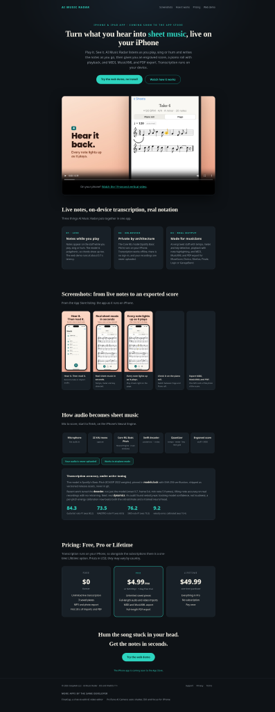
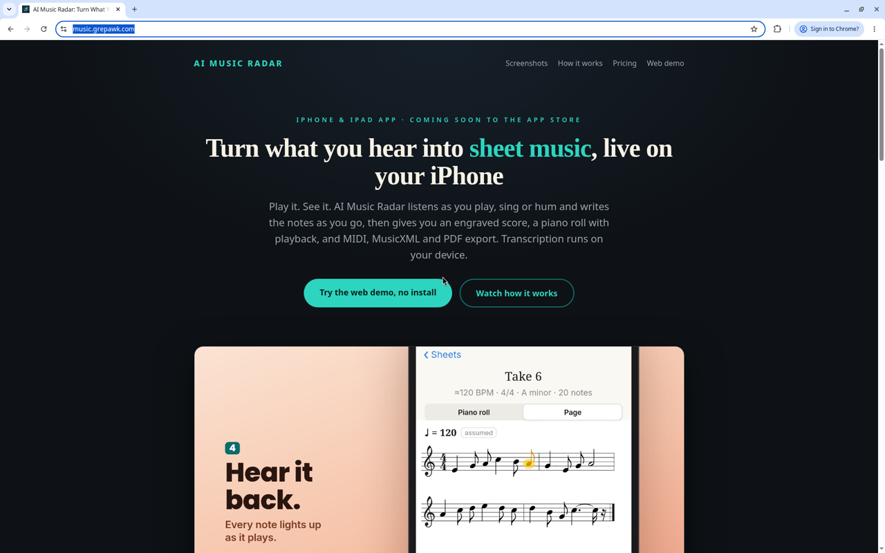
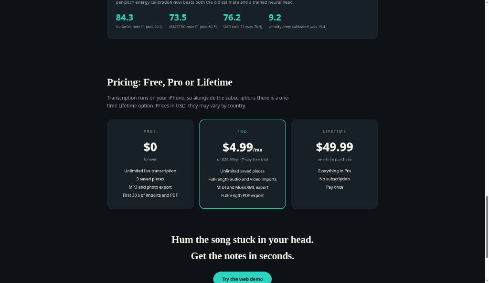
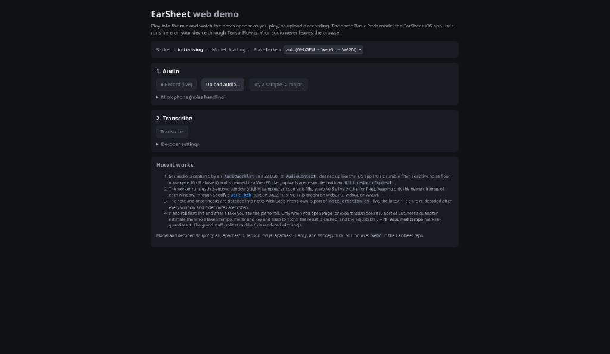
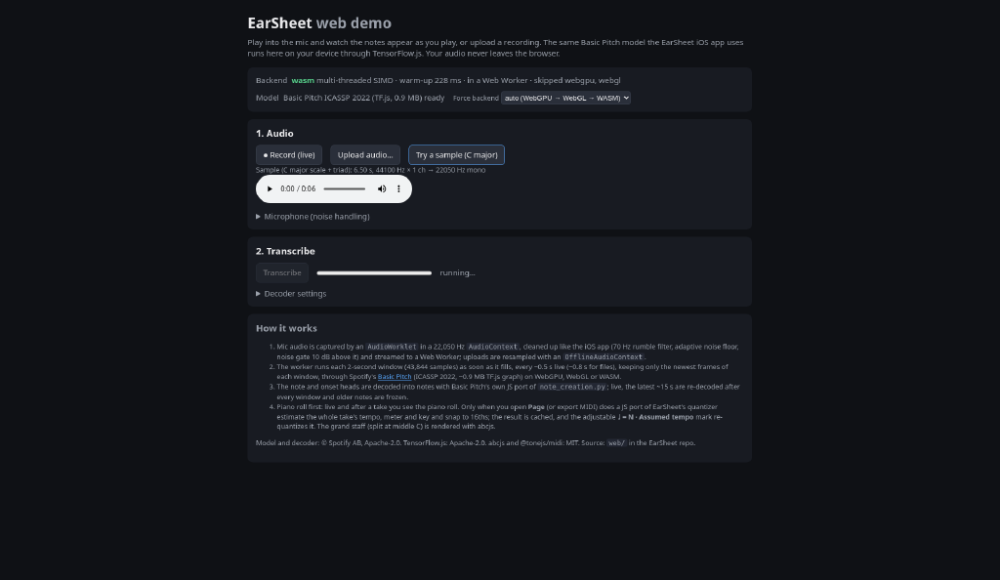
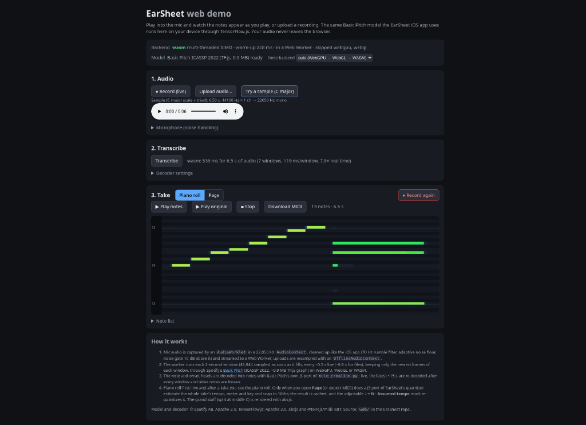
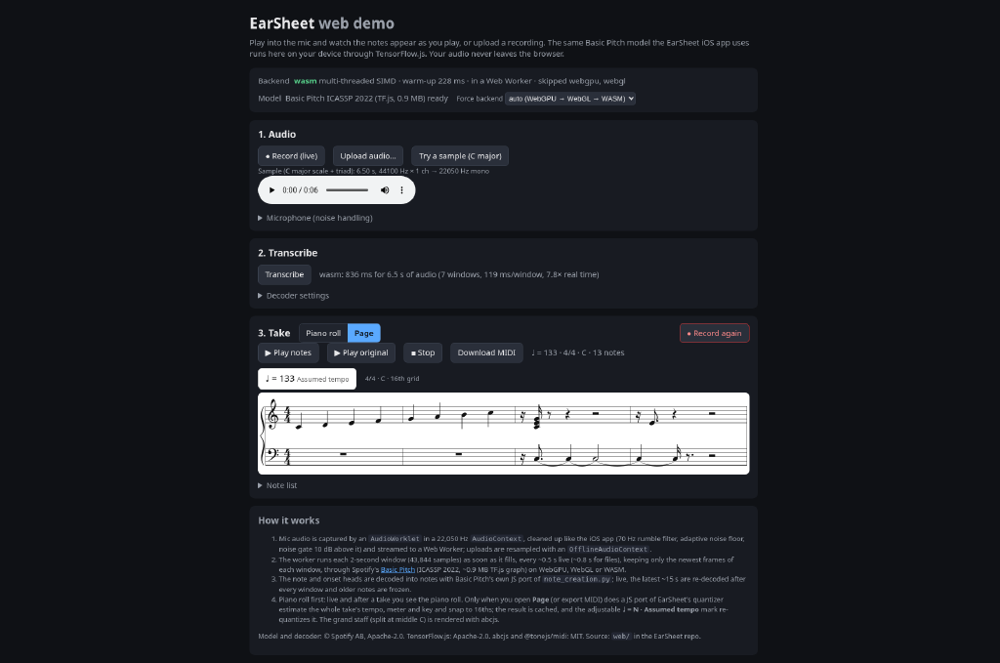

# music.grepawk.com: commercialization and ads research (2026-10-22)

Lean plan to turn AI Music Radar into a paid product. It reuses the finalcut Stripe paywall and gets it ready for X Ads and Reddit Ads.
Rule: any change ships to everyone and has one off switch (an env var). No cohorts and no feature flags.
Any figure without a cited source is a **proposal**, not data.

## 1. Where it lives
- Repo: `yishengjiang99/earsheet`. The site is `tools/music-radar-site/` plus `docs/explainer/index.html` and `docs/legal/music-radar/`. It deploys through the "Deploy music.grepawk.com" workflow to `/var/www/music-radar` on 64.23.239.208.
- The nginx vhost source is `tools/music-radar-site/nginx/music.grepawk.com.conf`, and the repo keeps a snapshot of the live config. I did not SSH to prod.
- Web demo: grepawk.com/music-hear, branded "EarSheet". The iOS app is `EarSheet.xcodeproj`, and `Products.storekit` holds its StoreKit products.

## 2. Product (from the HTML, the code and the parent's walkthrough)
AI Music Radar is an iPhone/iPad app that is not released yet ("coming soon"). It listens to music live and writes it out as sheet music, using Basic Pitch on the device.
It's for hobby and student musicians who want to write down a tune they heard or played, and for teachers.
Landing-page pricing: **Free** $0 (3 saved pieces; imports and PDF capped at 30 s). **Pro** $4.99/mo or $29.99/yr with a 7-day trial. **Lifetime** $49.99. There is no sign-up form or checkout on the page.
Consumer flow today: landing page → (no app to download) → web demo on another domain → notes on a staff after about 2 clicks and about 5 s.

  
   

Walkthrough issues:
1. Two names: "AI Music Radar" on the landing page and "EarSheet" in the demo.
2. No app to download yet, and the demo lives on a different domain (grepawk.com/music-hear).
3. The hero video may not play.
4. The Free tier says "unlimited" next to a 30 s cap, which reads as a contradiction.
5. The page shows technical F1 and threshold numbers that first-time musicians won't follow.
6. The sample's sheet-music view has a lot of rests.
7. The "Page" tab isn't a real button.

## 3. The finalcut paywall and how to reuse it
Source: `yishengjiang99/finalcut`, files `src/server/stripe.js`, `src/server/middleware.js`, `src/db.js` and `docs/STRIPE.md`.
- **Checkout:** `POST /api/create-checkout-session` takes a `priceId` and checks it against `allowedStripePriceIds`. It creates a Stripe Checkout session with `mode: 'subscription'`, success URL `/success?session_id=…`, and returns `url`. `POST /api/verify-checkout-session` confirms the session on return.
- **Webhooks:** `POST /api/stripe-webhook` uses the raw body and `stripe.webhooks.constructEvent`. `checkout.session.completed` calls `updateUserSubscription(email, true, subId)`. `customer.subscription.deleted` sets it back to false. `payment_intent.*` events are only logged.
- **Entitlement:** there is one boolean, `users.has_subscription`, read in `db.js` and checked in `middleware.js` (non-subscribers get a sample or free path). Apple IAP lives in `apple-iap.js`, and `docs/asc/STOREKIT.md` already warns against Apple/Stripe cross-unlocking.
- **Conversion tracking:** there is no X pixel (`twq`), no Reddit pixel (`rdt`) and no Conversions API anywhere in the code. The only telemetry is first-party (`telemetry.js`; music's `site.js` posts to `/api/telemetry/batch`).

Reuse plan (server work happens in finalcut, and music's client stays untouched for now):
1. Add Stripe prices for Music Pro monthly, Music Pro yearly and Music Lifetime, and add them to `allowedStripePriceIds`.
2. Lifetime needs `mode: 'payment'`. The current code hardcodes `subscription`, so choose the mode from the price.
3. Set `metadata.product = 'music'` on the session. Store per-product entitlements (`entitlements(user, product, source, active)`) instead of the single global `has_subscription`. Otherwise a paid finalcut user unlocks music and the reverse.
4. Make the `success_url` and `cancel_url` follow a request `return_to` that is on an allowlist (music.grepawk.com).
5. Conversions: from the webhook, send server-side events to the X Conversions API and the Reddit Conversions API: `Purchase` / `StartTrial`, with value, hashed email, and the click id (`twclid` / `rdt_cid`) captured on landing and passed through Checkout `metadata`. The off switch is `ADS_CAPI_ENABLED=0`.
   Docs: https://developer.x.com/en/docs/x-ads-api/measurement/web-conversions , https://business.reddithelp.com/s/article/Conversions-API
6. iOS purchases stay on StoreKit. Web Stripe only sells web access or desktop export unless App Store rules for linking out apply.

## 4. Market
### Competitors (real pricing)
| Product | Price | Source |
|---|---|---|
| AnthemScore 6 (desktop, one-time) | Lite $29, Professional $39 | https://www.lunaverus.com/purchase |
| Piano2Notes (Klangio) | $14.99/mo, or $6.24/mo billed annually; free tier 20 s | https://klang.io/help/compare-apps-and-subscriptions/ , https://www.itechguides.com/products/piano2notes/pricing/ |
| Klangio Transcription Studio | from $19.99/mo, Ultimate $29.99/mo | https://techyorker.com/compare/klangio-transcription-studio-vs-melody-scanner-vs-scorecloud-vs-piano2notes/ |
| Melody Scanner | $9.99/mo or $49.99/yr; free tier 1 min | https://www.itechguides.com/products/melody-scanner/pricing/ |
| ScoreCloud | Plus $5.99/mo, Songwriter $11.99/mo, Pro $20.99/mo | https://mobilestalk.net/compare/piano2notes-vs-scorecloud/ |

(The third-party aggregator prices were checked on 2026-09-20 according to those pages. Recheck them on the vendor sites before using them in ads.)

### Recommended pricing
Keep the current page prices: **Pro $4.99/mo or $29.99/yr with a 7-day trial, and Lifetime $49.99**. They undercut every subscription above (cheapest is ScoreCloud Plus at $5.99/mo), and Lifetime sits within reach of AnthemScore's $29–39 one-time price. Lead the ads with the yearly plan. Fix the Free tier copy to "Free: 3 pieces, 30-second clips".

### Audience
Hobby and returning musicians (piano and guitar first), music students, and teachers who write out melodies. Its edge over the competitors is that it runs live and on the device: point the phone at music and see notes.

## 5. Ads
**X Ads targeting** (keywords, interests, follower look-alikes; https://business.x.com/en/help/campaign-setup/campaign-targeting): interests in Music, Musical instruments, Education. Follower look-alikes of @musescore, @flowkey, @simplypiano and @Yousician. Keywords: "sheet music", "transcribe", "piano cover", "learn by ear".
**Reddit Ads targeting** (community and interest targeting; https://business.reddithelp.com/s/article/ad-targeting): r/piano, r/pianolearning, r/musictheory, r/WeAreTheMusicMakers, r/Guitar, r/learnmusic, r/composer, r/musescore, r/musicteachers. Reddit audiences are hostile to hard sell, so lead with the demo.

### Creatives (6)
1. **"Hum it, see it."** Video: someone hums, and notes appear on a staff in about 5 s. *"Play or hum anything. AI Music Radar writes the sheet music live, on your iPhone."* CTA: Try the free demo.
2. **"That song stuck in your head?"** *"Hold up your phone, get the notes. No uploads, it runs on-device."* CTA: Get notes free.
3. **Price contrast** (only once the competitor prices are rechecked): *"Pro transcription for $29.99/yr, not $14.99/mo."* (source: klang.io help page above)
4. **Teacher angle:** *"Turn a student's improvisation into a printable PDF before the lesson ends."*
5. **Privacy:** *"Your recordings never leave your phone."* This claim must match privacy.html.
6. **Reddit native:** text post from the dev, *"I built an on-device audio→sheet music app, roast my transcription"*, linking the demo.

### Test budget and KPIs (proposal, not sourced data)
- About $300 per platform over 14 days, 3 creatives each. Kill any creative below 0.5% CTR after 2,000 impressions. These numbers are my working assumptions; set them yourself.
- KPIs, all tracked server-side through finalcut: demo start rate, landing→checkout rate, trial starts, paid conversions, and cost per paid user against first-year revenue ($29.99 yearly).

## 6. Launch-readiness checklist (top 3 blockers first)
- [ ] **B1. Nothing to buy:** the app isn't released and the page has no checkout. Ship the App Store listing, or a web Stripe checkout for web access.
- [ ] **B2. No conversion tracking:** add X and Reddit CAPI from the finalcut webhook, plus click-id capture and the per-product entitlement and Lifetime `payment` mode.
- [ ] **B3. Broken funnel and brand:** pick one name (AI Music Radar or EarSheet), move the demo to music.grepawk.com, and fix the hero video, the "unlimited"/30 s copy, the F1 jargon, the sheet full of rests, and the dead "Page" tab.
- [ ] Privacy policy: disclose the ad pixels / CAPI (it currently says no third parties).
- [ ] X and Reddit ad accounts with billing; verify the domain.
- [ ] Off switch `ADS_CAPI_ENABLED` documented.
